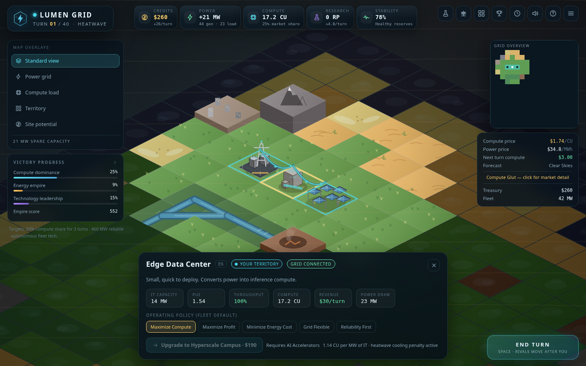
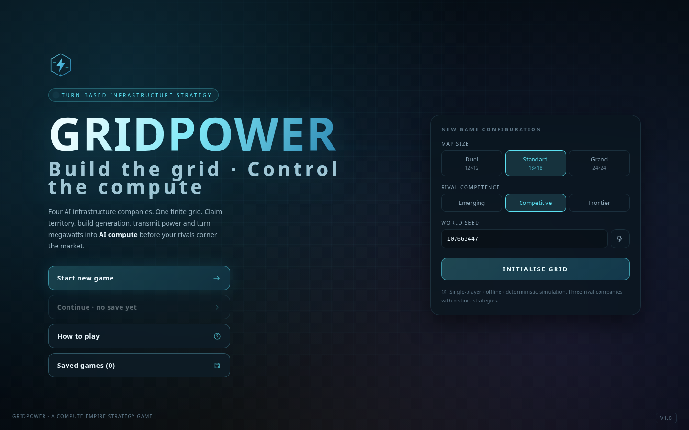
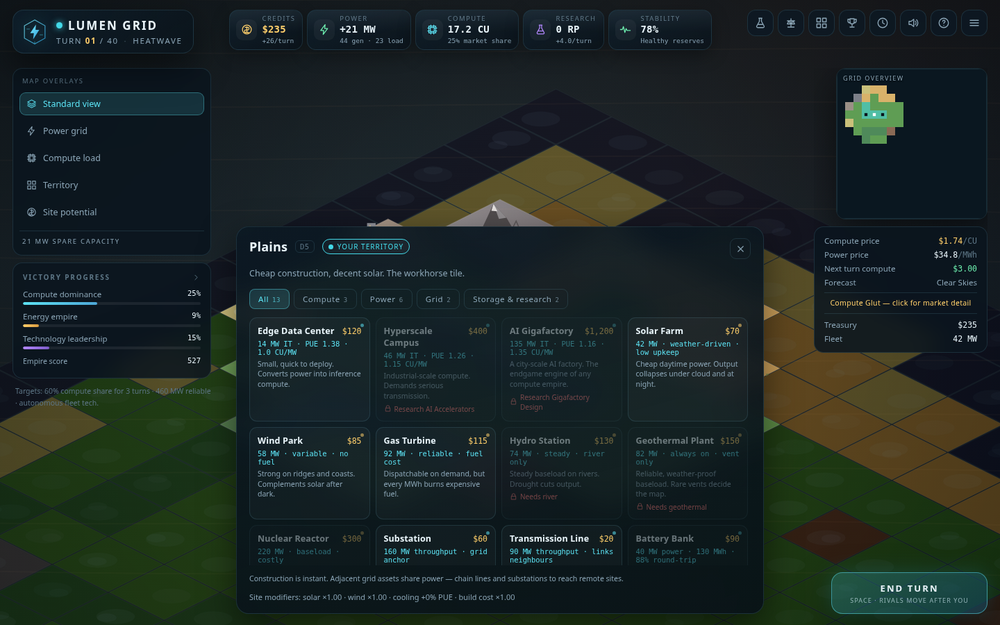
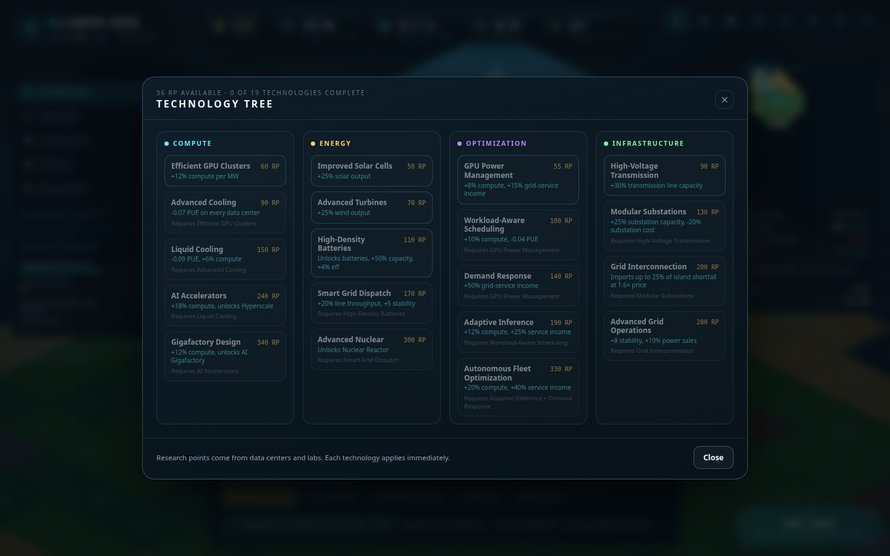
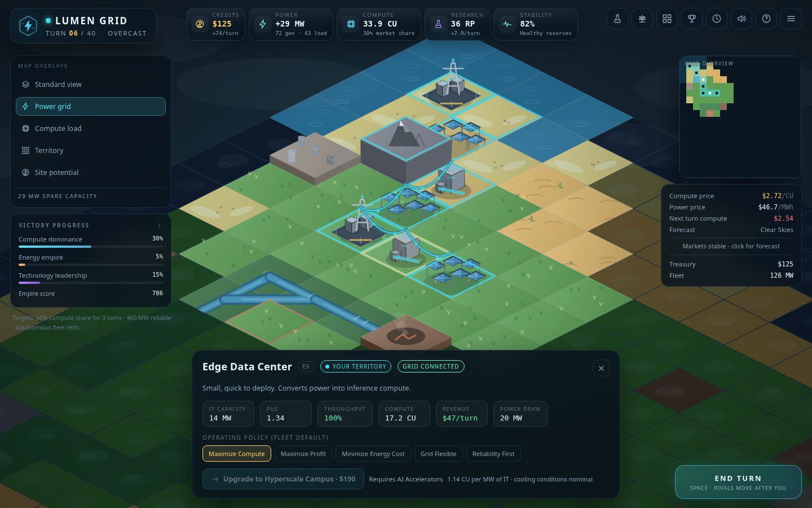
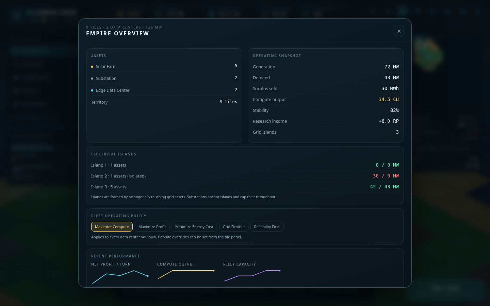
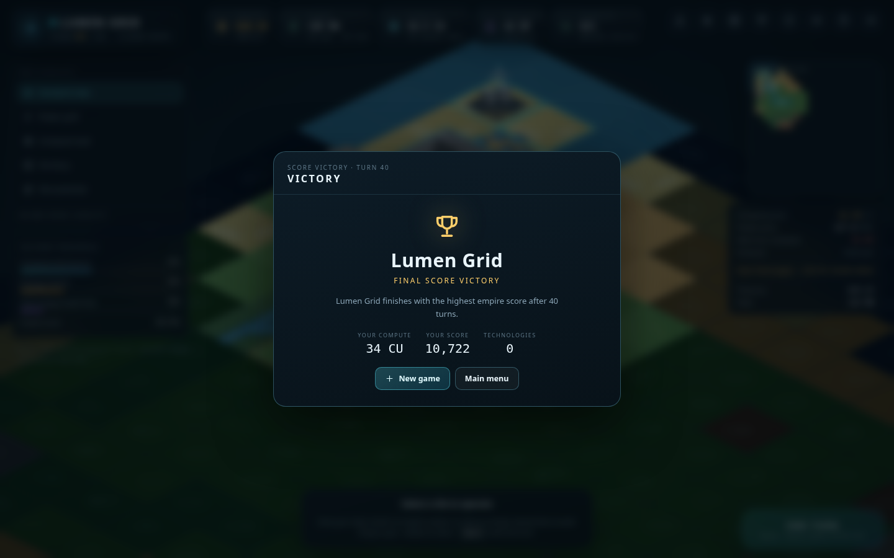

# GRIDPOWER

**Build the grid. Control the compute. Dominate the future.**

GRIDPOWER is a complete, single-player, turn-based 4X strategy game about AI infrastructure companies racing to build the most powerful compute empire on a shared electrical grid. Claim land, build power generation, transmit megawatts through substations and lines, and turn delivered electricity into AI compute before three rival companies do.



---

## Quick start

Requirements: **Node.js 22.12+** and npm (Vite 7 and the type-stripped simulation scripts). No backend, account, API key or network access is required at runtime.

```bash
npm install
npm run dev          # Vite dev server → http://localhost:5173
```

Production build:

```bash
npm run build        # type-check + bundle to dist/
npm run preview      # serve the production bundle
```

Tests and validation:

```bash
npm test             # 36 Vitest tests: engine, grid flow, AI legality, victory, saves, full matches
npm run sim          # headless AI league (8 complete matches) — accepts args: seeds=8 turns=40 size=18
```

Browser validation (optional, requires the dev server and Playwright's Chromium):

```bash
npm run e2e                # real clicks + state assertions + screenshots
npm run shots              # regenerate the screenshot set
BASE_URL=http://127.0.0.1:5300 npm run e2e   # when port 5173 is already in use
```

Both browser scripts default to `http://localhost:5173` and honour `BASE_URL`; they use the local Playwright Chromium install at `~/.cache/ms-playwright` (override with `CHROME_PATH`). They are development tools only and are not part of the shipped game.

---

## What is in the game

- **18×18 procedural map** (12×12 Duel, 24×24 Grand), seeded and reproducible, with continents, rivers, coasts, deserts, forests, mountains, geothermal vents, urban districts and gas basins.
- **Exploration and territory**: fog of war, escalating claim costs, neutral strategic substations, map reveals from expansion.
- **Five resources**: Credits, Power (MW flow), Compute (CU), Research (RP) and Grid Stability.
- **Six generation technologies** (solar, wind, gas, hydro, nuclear, geothermal) with terrain, weather, fuel and reliability differences.
- **A real electrical network**: orthogonal adjacency, substations and transmission lines with throughput limits, disconnected islands, congestion, battery storage, and a simplified max-flow dispatch solver.
- **Three data-center tiers** with IT capacity, PUE, cooling terrain, efficiency, utilization and per-site operating policies.
- **18-node technology tree** across compute, energy, optimization and infrastructure, with real mechanical effects.
- **Dynamic markets**: compute and power prices, fuel costs, grid-service revenue, 7 market events and next-turn forecasts.
- **Weather**: 7 weather states that change renewable output, cooling load and demand.
- **Batteries** with state of charge, charge/discharge limits and round-trip losses.
- **Three rival companies** with distinct personalities (renewables, hyperscale compute, flexibility/grid) driven by a deterministic utility AI.
- **Four victory paths**: compute dominance, energy empire, technology leadership, and turn-40 score.
- **Procedural isometric presentation**: animated turbines, solar glints, server LEDs, cooling steam, flowing power cables, weather overlays, fog silhouettes, minimap, overlays, contextual panels, tech tree, market screen, empire dashboard and turn reports.
- **Audio**: generated ambient pad and UI/building sound effects with a mute toggle.
- **Save/load**: autosave after every action plus manual slots in `localStorage`.

---

## Controls

| Input | Action |
|---|---|
| Left-drag | Pan the map |
| Mouse wheel | Zoom |
| Click | Select a tile |
| Click the selected tile | Close the panel |
| `WASD` / arrow keys | Pan |
| `Space` | End turn / continue after the summary |
| `Esc` | Close a panel or open the pause menu |
| `T` / `M` / `E` / `O` / `L` / `H` | Technology, Market, Empire, Objectives, Log, Help |
| `Ctrl/Cmd + S` | Save |

The main menu offers map size, rival competence and a seed. **Continue** restores the autosave.

---

## How a turn works

1. Inspect your empire: HUD (credits, power balance, compute, research, stability), right-hand market forecast, left-hand victory progress.
2. Claim adjacent territory and build on owned tiles. Construction is instant and paid from credits.
3. Set fleet or per-site data-center policies (compute, profit, energy cost, flexible, reliability).
4. Research technologies with accumulated RP.
5. End turn. Rivals act, then all companies dispatch power simultaneously: weather, generation, batteries, network flow, compute output, revenue, upkeep, fuel, grid services, stability, market and victory checks.
6. Read the turn report and the refreshed weather/market forecast.

Power is a flow, not a stockpile. Build generation, connect it to compute, and keep a reserve margin — or the grid will punish you.

---

## Project structure

```
src/
  engine/         Pure TypeScript simulation (no React, no canvas)
    config.ts     All balance values, structures, policies, techs, weather, market events
    types.ts      Domain types
    rng.ts        Seeded PRNG + value noise
    worldgen.ts   Procedural continents, rivers, resources, fair starts
    grid.ts       Islands, batteries, max-flow dispatch, compute/revenue
    simulation.ts Game creation, actions, turn resolution, victory, score
    ai.ts         Personality-driven utility AI
    save.ts       localStorage save/load
    index.ts      Public engine surface
  render/         Canvas2D isometric renderer (terrain, buildings, cables, weather)
  state/          Zustand store: UI state + engine actions
  ui/             React HUD, panels, modals, main menu, minimap
  audio/          Procedural WebAudio ambience and effects
tests/            Vitest suite (engine, AI, saves, full matches)
scripts/          Headless league, browser validation, screenshots
```

The simulation never imports React or canvas. The renderer is read-only against the game state. UI actions call engine functions; the store replaces the top-level game reference to trigger React re-renders.

---

## Screenshots

| | |
|---|---|
|  |  |
|  |  |
|  |  |

## Verification

- `npm test`: **36/36 passing** — world generation fairness, dispatch limits, transmission bottlenecks, island disconnection, battery conservation, PUE, research gates, construction costs, AI legality, all victory conditions, save/load round-trip, deterministic turn resolution, and three complete 40-turn AI matches.
- `npm run sim`: eight complete AI matches in under a second, no NaN/negative treasuries and stable invariants.
- `scripts/e2e.mjs`: real browser clicks for selecting, claiming, building, research, market, end-turn summary, empire panel, power overlay, and save; asserts state changes, HUD text and zero console errors.
- Production build: `npm run build` (TypeScript strict + Vite bundle).

See `BALANCE.md` for the match data and `ARCHITECTURE.md` for the design.

---

## Known limitations

- Single-player local only; no online multiplayer or cloud saves.
- Power flow is a simplified capacity-constrained max-flow model, not an AC solver (by design).
- The AI is heuristic/utility-based; it expands and builds credible networks but does not perform multi-turn opponent modelling.
- Terrain and buildings are procedurally drawn in Canvas2D (no external art/audio assets); the look is stylized rather than 3D-rendered.
- Rival companies are fixed to Helios / Titan / Volt with three competence levels.
- Balance was tuned from headless leagues and scripted browser sessions; unusual seeds can still produce unusually strong or weak starts.

---

## Documentation

- [GAME_DESIGN.md](GAME_DESIGN.md) — mechanics, economy, technology, AI and victory design
- [ARCHITECTURE.md](ARCHITECTURE.md) — simulation pipeline, power flow, rendering and UI architecture
- [BALANCE.md](BALANCE.md) — parameters, economic math and simulated match results

Third-party code: React, Zustand, Vite, TypeScript, Vitest, Playwright (dev only). No copyrighted game assets are used; all visuals and audio are generated in code.

---

## Build session summary

Recorded automatically for the one-shot build run. The game itself has no runtime or service dependency on this data.

**Session** `53abbc55d048d12804a8e41b` · deepseek-v4.1-flash-speed, speed lane
**Window** 2026-10-25 01:20:12 → 01:44:21 UTC · 24.2 min wall · 11.4 min busy · 6.66 turns/min

| Item | Value |
|---|---|
| Turns | 161 (160 tool calls + 1 stop) |
| Prompt tokens | 35,235,128 |
| Cached prompt tokens | 34,571,136 (98.1% hit) |
| Uncached prompt tokens | 663,992 |
| Completion tokens | 245,129 |
| Energy | 0.116441 kWh |
| Billed cost | $0.8446 ($5.00/kWh × 1.45 speed-tier multiplier; blended $7.25/kWh) |
| Token-card equivalent | $0.7652 ($0.15 in / $0.60 out / $0.015 cached per 1M) |

Latency: TTFT p50 0.80 s, p90 2.60 s, p99 14.1 s, max 20.2 s. Per-turn generation TPS (turns with ≥1 s decode, n=73): mean 606, p10 277, p50 615, p90 835, max 1205. Session-aggregate TPS: 541.7 generation basis / 168.9 wall-clock.

Lane service: 157/161 turns were served by the speed lane; 4 fell back to the standard pool at 01:22:41, 01:23:34, 01:24:28 and 01:26:37 (never again after 01:26). At those arrivals 1–3 concurrent lane requests existed and the lane had apparent room, so admission was refused for a reason not visible in `usage_events` (`speed_downgrade_reason` lives in `pricing_factors`, not pulled). Fallback turns were billed at standard $5.00/kWh (~$0.009 less than the lane price would have been).

Lane co-tenancy: 89/157 turns (57%) arrived with zero other-customer lane traffic; median concurrent others 0, p90 2, max 4. Own-account parallel sessions (33 requests) overlapped at most one at a time.
